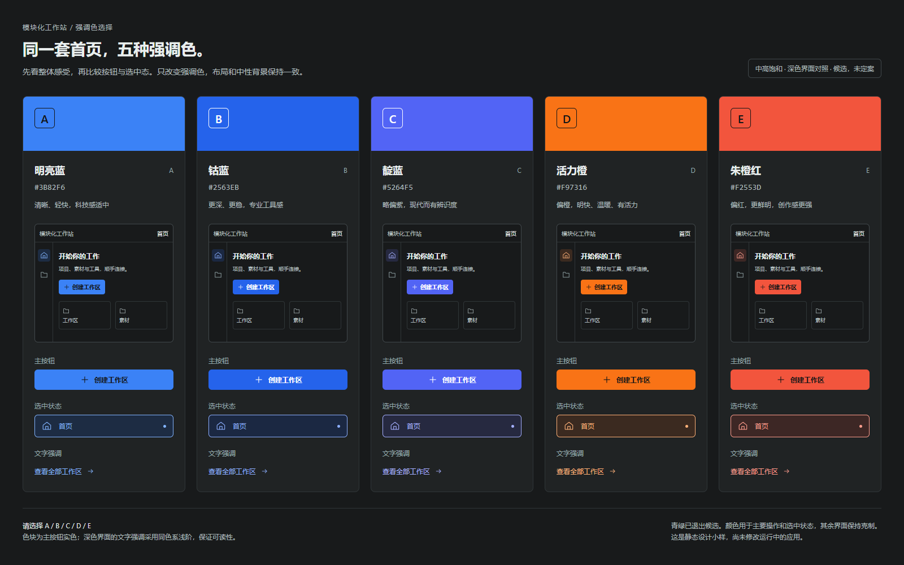

# 强调色与图标动效反馈 · 已选择 B 钴蓝

2026-10-20｜关联 [Issue #12](https://github.com/2539426035852ningmao-cmyk/modular-workstation/issues/12)、[D2 PR #15](https://github.com/2539426035852ningmao-cmyk/modular-workstation/pull/15)

产品所有者明确反馈：不喜欢青绿，希望改成中高饱和的蓝色或橙红色，随后明确回复 **“B 钴蓝”**。**B「轻量模块」指首页布局，配色 B 指钴蓝，两项选择均保留。** 下列小样作为比较记录；应用尚未改色，后续设计采用钴蓝，旧青绿退出基线。

当前设计映射：主按钮实色 `#2563EB`、按钮前景 `#FFFFFF`、深色强调文字/焦点 `#8BAEFF`、深色选中底面 `#1B2842`。浅色映射见 [D1 规范](DESIGN_PROPOSAL_D1.md)，仍须完成浅色页面验证。

| 编号 | 候选 | 主按钮实色 | 完整首页对照 |
| --- | --- | --- | --- |
| A | 明亮蓝 | `#3B82F6` | [A 首页](design/previews/d2-home-accent-A.png) |
| B | 钴蓝 | `#2563EB` | [B 首页](design/previews/d2-home-accent-B.png) |
| C | 靛蓝 | `#5264F5` | [C 首页](design/previews/d2-home-accent-C.png) |
| D | 活力橙 | `#F97316` | [D 首页](design/previews/d2-home-accent-D.png) |
| E | 朱橙红 | `#F2553D` | [E 首页](design/previews/d2-home-accent-E.png) |

小样保持布局和中性底色相同。深色界面的强调文字与选中边界使用同色系浅阶；主按钮实色与前景成对定义，避免饱和颜色上的文字不清晰。配色数据见 [accent-options.json](design/accent-options.json)。用户选色已记录；运行时变量随后续获批的 UI 实施 PR 更新。

## Morphicons 参考与后续边界

后续具体语义映射、可访问性与采用条件见 [项目同步与图标规范候选](DESIGN_SYNC_2026-10-20.md#4-图标优化候选proposed尚未接入)，仍为 Proposed，不表示运行时图标已替换。

已读取产品所有者提供的 [Morphicons 官方站](https://www.morphicons.com/)、[文档](https://www.morphicons.com/docs) 和 [Showcase](https://www.morphicons.com/showcase)。其图标数据驱动的状态变形可作为本项目候选；图标来源和动效层分别评估。本轮静态小样使用项目原有自绘 SVG，**没有安装 Morphicons，也未展示或验证其真实动效**。

候选使用场景：菜单展开/关闭、复制/完成、文件夹展开/收起、主题切换。只在状态改变时播放；全局导航不持续跳动，避免将普通操作当作装饰展示。具体是否引入、选哪组图标、动效时长和手感，后续通过小型真实交互样例与用户确认。

技术核验要点（官方说明，非本项目已通过测试）：

- 官方提供 React 接口；数据输入与现有框架图标组件不同，引入时需检查正确入口和实际打包结果。
- 官方 `reducedMotion` 默认值为 `never`；本项目若采用，必须显式选择 `user`，跟随系统减少动态效果偏好。
- Morphicons 官方声明 MIT，具体图标集有各自许可；实际安装时锁定版本、记录许可、验证离线资源与现有 CSP。
- 尚未执行本项目中的性能、连续快速切换、键盘、读屏、卸载清理或兼容性测试，不能把官网描述写成项目验收证据。

## 交付与验证

- [可编辑小样源](design/accent-options.html)、[导出脚本](design/render-accent-options.cjs)、[静态对比记录](design/previews/accent-options-validation.json)。现有开发依赖及 Edge 环境下运行 `node docs/design/render-accent-options.cjs` 复现。
- 五色总览 1600×1000，五个完整首页各 1440×900；总览尺寸/卡片数量检查通过。
- 每色检查主按钮文字、深色背景强调文字、选中底面文字，共 15 组，最低 4.667:1；属于指定组合的静态计算，未涵盖完整主题与全部状态。
- 此轮仅新增设计候选及说明，无依赖变化、应用代码变化或实际文件操作。撤销本次提交可移除候选，不影响原型。

后续按钴蓝继续专业页与首页修订，并完成深浅主题/状态验证。#10/#4/#5 与阶段关卡保持原有状态。
