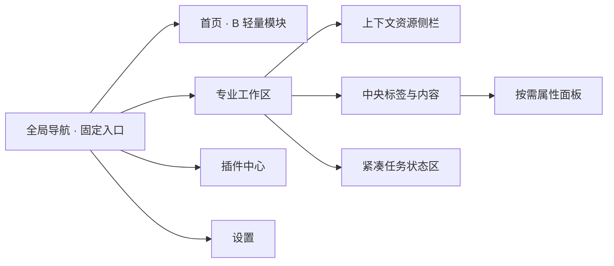

# S1 · D1 页面架构与设计规范提案

版本：V0.1｜2026-10-20｜状态：待视觉确认，未实施

更新：产品所有者随后否定青绿，提出中高饱和蓝色/橙红色方向。本文第 5 节颜色保留为历史候选；下一轮以 [五色审阅及最终选择](DESIGN_COLOR_REVIEW.md) 更新，B 首页布局继续保留。

关联：[设计任务 #12](https://github.com/2539426035852ningmao-cmyk/modular-workstation/issues/12)、[交接 PR #13](https://github.com/2539426035852ningmao-cmyk/modular-workstation/pull/13)、[桌面原型 #10](https://github.com/2539426035852ningmao-cmyk/modular-workstation/issues/10)。

## 1. 依据、范围与项目位置

产品所有者授权本轮完成 D1。方向为 **LobeHub 视觉美学 + Figma 专业工作台布局 + 保留 B「轻量模块」首页**。本提案定义设计稿和后续小范围实现的约束；所有新增尺寸、色值和组件规格仍为候选。

- 代码审计基线：main `1236f6160485a78ec933ae3922c2dac2ea080bda`，PR #11 已合并。
- 交接依据：分支 `docs/s1-lobehub-figma-design-handoff`，提交 `af9c1bb2db73b8babd8f7848c679069b73617abc` 的 [HANDOFF_S1_LOBEHUB_FIGMA.md](https://github.com/2539426035852ningmao-cmyk/modular-workstation/blob/af9c1bb2db73b8babd8f7848c679069b73617abc/docs/HANDOFF_S1_LOBEHUB_FIGMA.md)。读取时 PR #13 尚未合并。
- 项目唯一主实施任务仍是 #10，技术清单已完成，Issue 开放待产品验收。本次是按用户指令开展的 #12 设计准备，不改变任务关闭或看板状态。
- #4 Gemini 审查、#5 CI 继续保留；S0 未完成，S1 未验收。Electron/Tauri 正式比较仍待做。
- 本次仅新增/修订文档，不改 `src/`、Electron、安全策略、依赖或业务能力。

当前实现规范见 [DESIGN_FOUNDATIONS.md](DESIGN_FOUNDATIONS.md)。本提案通过视觉确认并在后续 PR 落地后，才逐项更新该文件的“已实现”部分。

## 2. D0 审计：保留项与差距

| 位置 / 当前事实 | 保留项 | D1 目标 / 后续变化 |
| --- | --- | --- |
| `src/App.tsx`：4 页导航、首页卡片，其余为空态 | 页面入口、中文优先、明确未实现状态 | 按 Home / Workspace / Plugins 模板拆分展示结构 |
| `src/styles.css`：224px 整体侧栏，窄于 700px 收为 64px | 固定全局入口、可见选中态和焦点 | 56px 全局 Rail 与按页启用的上下文侧栏分开 |
| 顶栏 56px、内容标题 29px、欢迎区至少 174px | 面包屑、清晰页面标题、B 模块化组织 | 顶栏候选 48px、标题 24px、欢迎区压缩为内容引导 |
| `src/tokens.css`：双主题、文字、间距、选中态等基础变量 | 同名语义变量与青绿强调基线 | 补齐浮层、悬停、按下、禁用、焦点、反馈与密度 |
| 尚无标签栏、可调面板、布局保存 | 当前简单状态切换保持可用 | 专业页定义折叠、选择详情、恢复默认及后续持久化契约 |
| 工作区、插件、设置暂无业务 | 诚实空态、不出现无效操作 | 设计稿标注未来功能；实现按独立任务增加真实能力 |
| `tests/window.test.cjs`：已有窗口/导航等检查 | 鼠标与键盘、可访问名称、无 Node 全局、离线、缩放检查 | 后续只针对实际变更补充面板/焦点/主题回归 |

必须保护的现有能力：本地启动、四入口导航、跟随系统主题、中英文文案、窗口关闭退出、渲染进程隔离、CSP 与外部跳转限制。现有测试使用部分 CSS 选择器和确切色值；后续结构/色值若经批准改变，应保留行为断言并更新相应预期，不能靠删除安全和导航检查消除失败。

## 3. 页面架构与导航

### 3.1 稳定的外壳

全局导航顺序沿用“首页 / 工作区 / 插件 / 设置”。Rail 中用统一线性图标和可见短标签，避免只靠编号识别；设置位于底部。图标提示作为辅助，读屏名称和当前页标记始终保留。



该图表达区域关系，不表示当前存在文件、插件或任务运行能力。顶部保留系统窗口控制，优先沿用现有原生标题栏；本轮不设计无边框窗口或替换系统拖动区域。

### 3.2 三类页面模板

| 模板 | 默认结构 | 可选区域与内容原则 |
| --- | --- | --- |
| Home | Rail + 顶栏 + 居中模块内容 | 默认无上下文侧栏、Inspector 或底部常驻任务条；保留 B 方向，欢迎说明压缩；未来有真实数据后显示最近工作区 |
| Workspace / Assets | Rail + 资源侧栏 + 中央标签/工具栏/内容 + 状态条 | Inspector 在用户请求详情或选中对象时按空间规则出现；空工作区优先说明下一步；文件素材页是未来官方插件模板 |
| Plugins | Rail + 分类侧栏 + 搜索/列表主体 | 默认不加专业 Inspector；插件详情在主体内打开，保持分类、筛选和滚动位置；权限列表在详情/安装确认中清晰可见 |

Settings 复用普通页面外壳：Rail + 设置分组 + 表单主体，不强加专业面板。设计稿可描绘目标表单，当前应用继续保留未实现说明。

专业工作区的区域次序：

```text
系统原生标题栏
┌──────┬─────────────────────────────────────────┐
│      │ 顶栏：工作区名称 / 路径 / 页面级命令       │
│ Rail ├───────────┬─────────────────┬───────────┤
│      │ 上下文栏  │ 标签 / 工具栏   │ 属性面板  │
│      │ 树或分组  │ 中央工作内容    │ 按需显示  │
│      ├───────────┴─────────────────┴───────────┤
│      │ 任务状态：摘要 / 详情入口                 │
└──────┴─────────────────────────────────────────┘
```

### 3.3 导航、选择与返回

1. 全局导航改变页面；上下文栏只改变本页分类/资源，避免两层导航重复列出全局入口。
2. 工作区标签对应打开的内容；单击资源选中并更新详情，打开动作再产生标签。具体文件打开方式在对应功能任务确认。
3. 收起 Inspector 不清除选择；清除选择后显示紧凑说明，窄窗口下关闭临时详情面板。
4. 插件“查看详情 → 返回列表”恢复筛选/滚动状态；安装需要单独展示来源、权限与真实结果，不能将详情页当作授权完成。
5. 页面切换后焦点落到主内容标题；面板关闭后焦点返回触发按钮。正常刷新和状态更新不得抢走用户输入焦点。
6. 概念稿使用的最近项目、素材和插件全部标记“示例数据 / 尚未实现”，真实应用里只展示真实数据或空态。

## 4. 尺寸、折叠和 Windows 缩放

### 4.1 候选布局参数

下表单位均为 **CSS px**；原生窗口尺寸还受 Windows DPI 与应用缩放影响，不能把 CSS 尺寸叫作物理像素。

| 区域 | 默认 | 最小 / 最大 | 调整与隐藏规则 |
| --- | --- | --- | --- |
| Rail | 56 | 56 / 56 | 核心四入口稳定存在；短标签配图标，按钮高 48 |
| 上下文侧栏 | 240 | 220 / 280 | 专业页、插件页启用；可受限调整；收起时为 0，展开按钮移到顶栏 |
| 顶栏 | 48 高 | 48 高 | 路径中段省略，完整路径可访问；不与系统窗口控件重叠 |
| 标签行 / 工具栏 | 各 36 高 | 各 36 高 | 仅需要时出现；标签内部滚动、次要工具收进菜单 |
| Inspector | 288 | 280 / 320 | 专业页可调整；选中对象不强制挤占中央区 |
| 状态条 | 24 高 | 24 高 | 专业页紧凑摘要；详情展开为覆盖层，避免反复挤动画布 |
| 中央操作区 | 自适应 | 宽目标 ≥ 480 | 小视口可降至 320；低于此阈值启用单列和内部滚动 |
| Home 内容 | 最大 1120 宽 | 两侧留白 24–40 | 模块最小 240，自动 3/2/1 列；窄窗口允许垂直滚动 |

调整手柄显示 1px 分隔线，鼠标命中区 8px；未来实现时提供可聚焦的 separator、方向键调整与恢复默认入口。拖动实时跟随，不添加延迟动画。

### 4.2 可重复计算的折叠顺序

以应用内容视口宽度 `W` 计算，扣除实际分隔边线后仍须满足中央宽度：

- `W ≥ 1120`：允许侧栏与 Inspector 同时停靠；先约束用户面板宽度，再隐藏次要区域，确保中央 ≥ 480。若用户拉宽两边导致不足，先将 Inspector 转覆盖层。
- `800 ≤ W < 1120`：保留侧栏，Inspector 变为临时覆盖层；用详情按钮打开，不因选择自动弹出。
- `640 ≤ W < 800`：侧栏默认收起，用户可临时展开；Inspector 继续覆盖显示。两种覆盖层互斥，不叠加挤压内容。
- `W < 640`：Rail 保留；侧栏和详情以可关闭的单个覆盖面板呈现，宽度 `min(320, W - 56)`；模块单列，工具进入更多菜单。
- 竖向可用内容不足 320 时，折叠次要工具与任务详情；列表/正文在各自区域滚动，主要操作始终可达。
- 自动折叠是当前视口的显示结果，不覆盖用户保存的面板偏好。未来重启恢复布局时按当前视口重新约束；“恢复默认布局”始终可访问。

布局保存属于后续 S2 实现，不在本次文档变更中交付。当前原型的 800×540 原生最小窗口配置保持不变；需在真实 Windows DPI 下复核它与新布局规则是否适配。

### 4.3 设计和验证矩阵

| 检查层 | 范围 | 通过条件 / 证据 |
| --- | --- | --- |
| 设计稿 | 1920×1080、1366×768 参考屏幕 | 注明系统缩放、标题栏和应用内容边界，不能把屏幕分辨率直接当 CSS 视口 |
| CSS 适配 | 1120 / 800 / 640 / 400 内容宽度 | 三类模板无页面级横向溢出；工具可达、文字可读、面板按规则折叠 |
| Electron 应用缩放 | 100 / 125 / 150 / 200% | 记录实际 `innerWidth/innerHeight`、主题、截图与焦点操作结果 |
| Windows DPI | 100 / 125 / 150 / 200% | 在真实系统设置测试，检查拖动、中文输入和多显示器切换；不能用 CSS 缩放冒充已测 |

本表是未来验收计划。本轮没有执行上述新布局验证；现有 PR #11 的基础 200% 应用缩放测试也不能替代这些检查。

## 5. 深浅主题与语义 Token 候选

### 5.1 迁移原则

`src/tokens.css` 继续作为唯一运行时来源。下表是设计稿候选数值，尚未写入 CSS。现有变量保留名称；新增变量先明确用途再落地。强调色沿用 B 的青绿基线，其他表面向中性靠近，最终以 D2 深浅稿确认。

| 变量 | 深色候选 | 浅色候选 | 用途 |
| --- | --- | --- | --- |
| `--color-bg` | #181A1B | #F5F6F6 | 中央基础背景 |
| `--color-sidebar` | #141617 | #ECEFEF | Rail / 上下文栏 |
| `--color-surface` | #202324 | #FFFFFF | 内容容器 |
| `--color-surface-subtle`（新增） | #1C1F20 | #F8F9F9 | 分组底面 |
| `--color-surface-elevated`（新增） | #2A2E30 | #FFFFFF | 菜单 / 对话框 |
| `--color-border` | #849497 | #63767E | 需要辨认的控件边缘；普通分隔使用 divider |
| `--color-divider`（新增） | #303638 | #E1E6E7 | 非交互区域分隔 |
| `--color-text` | #E9EFEE | #1E2B34 | 主要内容 |
| `--color-muted` | #AFBCBE | #526970 | 次文字 |
| `--color-subtle` | #97AAAD | #53676D | 辅助文字，仍须可读 |
| `--color-disabled`（新增） | #718084 | #7E8C91 | 禁用内容，说明原因 |
| `--color-accent` | #9BD5D3 | #1D6674 | 强调文字 / 图标 |
| `--color-selected` | #254044 | #D7E8E9 | 选中底面 |
| `--color-selected-border` | #6FADAD | #317684 | 选中边界 |
| `--color-hover`（新增） | #2D3436 | #E7EDEE | 悬停底面 |
| `--color-pressed`（新增） | #374246 | #DCE6E8 | 按下底面 |
| `--color-focus`（新增） | #9BD5D3 | #1D6674 | 焦点轮廓 |
| `--color-success` | #89C9B0 | #287265 | 完成 / 可用 |
| `--color-warning`（新增） | #E4BC74 | #835300 | 风险 / 待处理 |
| `--color-error`（新增） | #F2A5A5 | #B23535 | 失败 / 危险操作 |
| `--color-info`（新增） | #9CC7EB | #245F95 | 中性信息 |

正文与辅助文字要求对其实际底面至少 4.5:1；焦点和需要识别的状态边界至少 3:1。分隔线仅用于分组，不独立承载交互状态。反馈色配图标和文字，不只显示彩点；禁用项说明前置条件。

`--color-welcome` 和 `--color-welcome-border` 暂沿用现有定义；D2 将欢迎区改为较轻的引导区域后，再决定保留、映射至通用变量或弃用，避免一次性断开已有样式。

### 5.2 字体、空间、形状、层级与动态

| 类别 | 候选规范 |
| --- | --- |
| 字体 | Segoe UI / Microsoft YaHei UI / sans-serif，随本地系统提供；本轮不新增在线字体依赖 |
| 字阶 | 12/14/16/20/24；正文 14/22 行高、辅助 12/20、页面标题 24/32；常规 400、强调 600；11px 限非关键元数据 |
| 间距 | 沿用 4/8/12/16/20/24/32；组内 8、组间 16、区域间 24–32 |
| 控件 | 普通 36 高，紧凑 32，Rail 48；图标 16/20、统一线宽；需有文字或可访问名称 |
| 圆角 | 沿用 4/6/8；新增 12 仅用于浮层 / 对话框；整圆限状态点和头像 |
| 边框 | 1px；焦点 2px、外偏移 2px，避免被容器裁切 |
| 阴影 | 内容卡片无阴影；菜单候选 `0 8px 24px #00000026`，对话框 `0 16px 48px #00000040`，同时有明确底面和边框 |
| 层级 | 基础 0、粘性栏 10、覆盖面板 20、菜单 30、模态对话框 40；同一时刻只开放一个阻断式模态层 |
| 动态 | 状态过渡 120ms、面板/浮层 160ms；拖动即时；减少动态偏好关闭非必要位移和渐变过渡 |

紧凑密度是专业页面候选，不把现有 42px 导航直接全局改成 32px。中文名称和英文长词须覆盖换行、省略与完整提示；文件名称输入要为中文输入法候选保留空间。

## 6. 组件、状态与可访问性

| 组件族 | 必需状态 | 操作契约 |
| --- | --- | --- |
| 全局导航 / 分类项 | 默认、悬停、按下、选中、焦点、不可用原因 | 全局使用 `aria-current`；图标配可见短标签和可访问名称 |
| 标签 / 工具栏 | 激活、未激活、溢出、未保存（未来） | 标签用方向键、Home/End，Tab 离开标签组；关闭后焦点到相邻标签 |
| 侧栏 / Inspector | 展开、收起、覆盖、无选择、多选 | 折叠按钮有 `aria-expanded`；关闭覆盖层返回触发点，Esc 可关闭 |
| 搜索 / 输入 / 表单 | 空、输入中、结果、无结果、校验失败、禁用 | 有标签，错误关联输入，中文组合输入期间不触发提交 |
| 树 / 列表 / 网格 | 空、加载、选中、多选、失联、错误 | 列表选择与打开分开；键盘行为按组件语义实现，删除须区分引用与源文件 |
| 空态 / 加载 / 失败 | 首次使用、无匹配、进行中、可重试、完成 | 首次空态给下一步；无匹配给清除筛选；可重试错误保留上下文与诊断入口 |
| 菜单 / 对话框 | 开启、焦点移动、不可用、确认、取消 | 菜单方向键；模态圈定焦点并恢复；危险操作写清对象和后果 |
| 提示 / 任务状态 | 进度、取消中、失败、完成 | 短提示不承担唯一错误证据；任务详情可回看，避免频繁读屏播报 |
| 插件详情 / 权限 | 来源、兼容、权限申请、已授权、撤销、失败 | 不预选高风险权限；不得用“官方”替代实际授权与隔离 |

尚无真实异步任务时，应用不模拟进度或错误。设计稿中的状态变体明确标注“交互规格”。高对比模式下使用系统颜色/边界的适配方案需在实现阶段验证。

### 插件 UI 边界

- 主程序拥有全局 Rail、工作区容器、主题、语言、焦点和权限入口；插件仅填充已约定内容槽位。
- 未来 SDK 暴露主程序语义变量和受控组件适配层；不让插件修改全局样式、抢占导航、覆盖系统窗口操作。
- 不将外部组件库的私有主题对象直接当作稳定插件 API；后续兼容策略与插件权限机制单独评审。

## 7. 组件库评估边界

本轮保持 React + CSS 的现有工程，不安装 Lobe UI、shadcn/ui 或其他组件库。D1 只定义后续对照方法，不宣称完成包体积、许可或兼容性实测。

| 候选路径 | 后续最小评估样例 | 需记录的证据 |
| --- | --- | --- |
| 现有样式 + 少量受控基础组件 | 导航、菜单、对话框、输入与主题 | 自主维护成本、焦点/键盘正确性、重复样式规模 |
| Lobe UI | 同一组组件与主题接入 | 当前包版本/许可证、React/Electron 兼容、实际依赖图、样式冲突、产物增量 |
| shadcn/ui | 同一组组件与主题接入 | 当前生成组件及底层依赖许可证、样式工具改造、源码维护责任、产物增量 |

评估使用隔离分支和同一组场景；体积对比须采用相同构建方式，检查离线资源和现有 CSP，取得产品所有者决策后才引入依赖。上述候选没有优先替换授权。

## 8. D2 高保真制作顺序与交付清单

| 顺序 | 页面 | 重点 | 配套状态 |
| --- | --- | --- | --- |
| 1 | 首页 Home | B 模块结构、轻量引导、Rail 识别、字体与留白 | 首次启动空态；未来有真实项目后的示例状态 |
| 2 | 文件素材工作区 Assets | 树 / 标签 / 内容 / Inspector / 状态区，验证专业密度 | 未关联资源、选择详情、加载/失联/失败规格 |
| 3 | 插件中心 Plugins | 分类与搜索、列表、详情、权限可读性 | 无插件、无匹配、离线、权限确认/失败规格 |
| 4 | 同三页的浅色与窄窗口补稿 | 验证同一语义与折叠规则 | 页面级横向溢出、文字对比、面板入口与焦点说明 |

D2 至少交付三张深色主稿和三张浅色对照稿；主稿先以 1440×900 CSS 内容画布制作，再补 800 与 400 宽的专业页折叠示意。屏幕/DPI 验证仍按第 4 节执行；稿件尺寸不代表实机测试结果。

每张稿应附：页面模板、主题、内容尺寸、示例数据标记、交互热点说明、空/加载/错误变体、与当前代码的变化说明。稿件中不可把模拟的安装、文件操作、布局保存描述为已可用。

视觉确认顺序：先看首页与专业页是否符合整体审美，再确认密度/强调色/面板空间，再逐项确认浅色与组件状态。图片需要实际展示；文本提案或 PR 合并不代表审美通过。

## 9. 后续实施边界与验收

D1 交付后，唯一建议下一步为 **D2 首页深色高保真首稿**，使用本提案中暂定变量；后续按第 8 节扩展。#10 的产品验收和任务切换按项目流程保留，不因设计准备自动关闭 #10 或宣布阶段完成。

视觉确认并获实施授权后，建议按三个小 PR 交付：主题/字体/状态变量 → Rail 与普通页面 → 专业布局容器。插件业务、文件操作、布局持久化各自进入独立任务；保持现有导航、离线与安全检查。

| 本轮检查 | 状态 |
| --- | --- |
| 对照实际源码、项目文件、交接分支、Issue/PR | 已执行，基线见第 1 节 |
| 相对文档链接 | 已检查本次 4 个文档的 16 个相对链接，目标文件均存在 |
| 差异空白检查 | 提交前执行 `git diff --check`，最终结果在 PR 记录 |
| 候选色静态对比计算 | 21 个颜色变量；114 组文字/边界配对通过，文字最低 4.507:1，边界最低 3.516:1；不等于完整视觉验收 |
| 断点宽度预算 | 5 组区域宽度算术检查通过，含分隔线；不等于浏览器或 Windows 实机检查 |
| 新高保真稿、组件库兼容/体积、Windows DPI、新布局交互 | 尚未执行 |
| 应用构建 / Electron 测试 / 打包 | 本轮仅修改文档，未重复执行；历史证据见 PR #11 |

回滚：本提案只改文档，撤销对应 PR 即可；应用代码与现有便携构建保持原状态。

静态对比方法：将 sRGB 通道 `c`（0–1）按 `c <= 0.04045 ? c/12.92 : ((c+0.055)/1.055)^2.4` 线性化；亮度 `L = 0.2126R + 0.7152G + 0.0722B`；对比 `(L亮+0.05)/(L暗+0.05)`。每主题的 8 类文字分别与 6 类底面配对，3 类边界分别与 3 类底面配对，共 114 组。禁用色与非交互分隔线不作为正文/控件状态色参与通过声明；悬停/按下等其他实际组合仍需在组件设计与实现时检查。

## 10. 参考与核验记录

- 本项目：[PRODUCT](PRODUCT.md)、[ROADMAP](ROADMAP.md)、[DECISIONS](DECISIONS.md)、[QUALITY_GATES](QUALITY_GATES.md)、[现有设计规范](DESIGN_FOUNDATIONS.md)。
- [LobeHub 官方 DESIGN.md](https://github.com/lobehub/lobehub/blob/canary/DESIGN.md)：2026-10-20 已读取，参考语义变量、12/14/16 字阶、4px 间距、克制圆角和短时动效；本项目保留自己的字体、强调色、页面内容及技术选择。
- [Lobe UI Design Tokens](https://ui.lobehub.com/design-tokens)：2026-10-20 已打开官方页面；不据此宣称当前依赖版本、性能或兼容性已验证。
- [Figma 官方导航与左侧栏说明](https://help.figma.com/hc/en-us/articles/360039831974-Explore-the-navigation-bar-and-left-sidebar)：2026-10-20 已读取，确认导航栏与动态侧栏分层、侧栏可调整及收起机制。本文具体区域尺寸、断点、页面模板是本项目提案，不是 Figma 官方规范数值。
