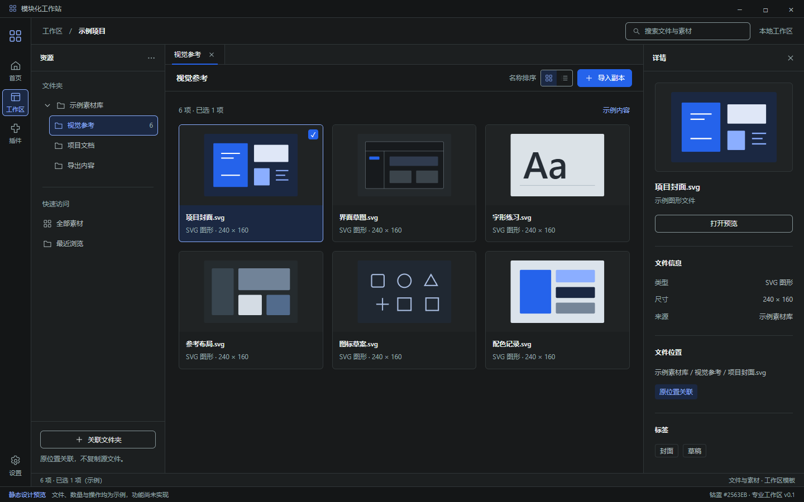

# D2 · 文件素材专业工作区深色首稿

日期：2026-10-20｜版本：V0.1｜状态：钴蓝已选定，页面待视觉确认

关联：[Issue #12](https://github.com/2539426035852ningmao-cmyk/modular-workstation/issues/12)、[D1 规范](DESIGN_PROPOSAL_D1.md)、[首页稿](DESIGN_REVIEW_D2_HOME.md)、[配色选择记录](DESIGN_COLOR_REVIEW.md)。保留 B 轻量首页；本页展示进入专业工作区后的布局。

## 预览与源文件

- [可编辑 HTML/CSS/SVG 源稿](design/d2-assets-dark.html)：直接在本地浏览器打开；无业务脚本或远程资源。
- [800px 预览](design/previews/d2-assets-dark-800.png)、[400px 预览](design/previews/d2-assets-dark-400.png)。中央区域内部滚动，其余素材位于截图下方；不是整个页面横向溢出。
- 主图 1440×900、浏览器设备比例 1，含模拟系统标题栏及持续可见的设计预览标识；不是运行中的 Electron 应用截图。
- [实际布局检查记录](design/previews/d2-assets-validation.json)。已有开发依赖与 Microsoft Edge 的环境中，从仓库根目录运行 `node docs/design/render-d2-assets.cjs` 可重新导出。

## 本页的设计决定

1. **统一钴蓝**：主要动作使用 #2563EB 和白字；深色界面的强调文字与焦点用 #8BAEFF，选中容器用 #1B2842。与首页共用 D1 的 23 个颜色变量。
2. **专业工作区分层**：全局导航 Rail 56px、上下文资源树 240px、中央素材区、详情面板 288px；顶栏 48px。1440px 主图中中央宽 856px。
3. **两种文件入口分清**：“关联文件夹”说明原位置关联、不复制源文件；“导入副本”表示另一种未来动作。均为静态示意，不实际访问、复制或删除文件。
4. **内容为明确的示例**：六张缩略图由本稿 SVG 图形组成，名称、数量、尺寸、路径、标签均为示例，不使用用户私有素材或真实文件记录。页面顶部与底部标明示例性质。
5. **详情按空间出现**：宽度不足 1120px 时隐藏详情面板，显示“详情”入口；不足 800px 时再隐藏资源树，显示“资源”入口。入口尚无展开行为，未来覆盖面板的焦点与关闭规则需另行实现。

## 尚未实现的交互与状态

| 区域 | 目标行为 | 本稿范围 |
| --- | --- | --- |
| 文件夹树、标签页、搜索和排序 | 导航真实索引、保持工作上下文 | 视觉排布，无数据操作 |
| 素材卡片 | 选择、多选、键盘导航及预览 | 六张示例、一个选中样式 |
| 文件详情 | 显示真实属性与关联来源 | 固定示例信息 |
| 关联与导入 | 选择路径并反馈权限、进度与结果 | 两种入口及含义说明 |
| 窄窗口面板 | 按需打开、关闭、焦点回到入口 | 仅隐藏面板及显示入口的布局 |

首次空白、索引加载、无权限、文件失联、导入失败等状态尚未制作。本稿没有证明文件索引、缩略图性能或文件系统权限可用。图标为本稿静态 SVG，Morphicons 尚未安装、接入或进行动效测试。

## 实际验证与限制

- Edge 静态导出与布局检查已执行，1440/1120/800/640/400 五种宽度全部通过。
- 中央区域宽度依次为 856/536/504/584/344px；两侧面板按上述断点隐藏。全局设置入口和审阅标识保持可见。
- 五种宽度均未出现页面横向溢出或被检查文件名、类型、详情标题、工具栏标签的横向裁切；控制台错误和 HTTP 请求均为 0。
- 源稿中 23 个颜色变量与 D1 当前值一致；1440/800/400 三张截图已人工查看。
- 这只验证静态稿，不等于应用功能、键盘操作、屏幕阅读器、Windows DPI 或产品验收通过。未改应用源码、Electron、组件库或依赖；没有重复运行应用测试。
- 回滚：撤销本设计提交即可移除源稿、预览与说明；现有可运行原型不受影响。

## 下一步

[插件中心深色首稿](DESIGN_REVIEW_D2_PLUGINS.md)已制作；下一步补三类页面浅色对照与必要状态稿。完整 D2 视觉验收仍未完成；#10 保持待产品验收，#4/#5 与 Electron/Tauri 实测对照继续保留，不能宣布 S0/S1 完成。
