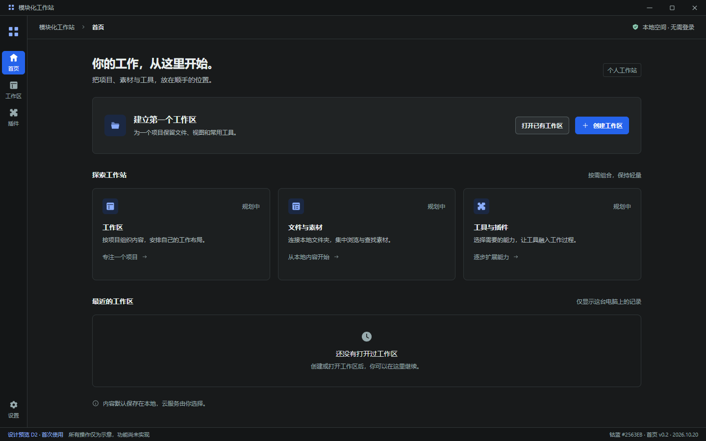

# D2 · 首页深色高保真首稿

日期：2026-10-20｜版本：V0.2 钴蓝修订｜状态：颜色已选定，完整页面待视觉确认

**产品所有者已选择 B 钴蓝 #2563EB，下方首页和源稿已更新；首页 B 布局继续保留。五色比较记录见 [配色审阅](DESIGN_COLOR_REVIEW.md)。Morphicons 图标与动效仍为待实测候选。**

关联：[Issue #12](https://github.com/2539426035852ningmao-cmyk/modular-workstation/issues/12)、[D1 提案 PR #14](https://github.com/2539426035852ningmao-cmyk/modular-workstation/pull/14)、[设计交接 PR #13](https://github.com/2539426035852ningmao-cmyk/modular-workstation/pull/13)。本稿以 D1 候选规范为起点，尚不代表 D1 已获全部视觉确认。

## 预览与源文件

- [可编辑 HTML/CSS 源稿](design/d2-home-dark.html)：本地浏览器直接打开；不请求远程资源，不含业务脚本，控件为静态示意。
- [800px 宽适配示意](design/previews/d2-home-dark-800.png)、[400px 宽适配示意](design/previews/d2-home-dark-400.png)：页面会纵向滚动，未进行 Windows DPI 实机测试。
- 主图导出尺寸 1440×900、浏览器设备比例 1；其中含 32px 模拟系统标题栏和 28px 稿件审阅标识。这是设计画布，不是运行中的 Electron 应用截图。
- [静态导出与布局检查结果](design/previews/d2-home-validation.json)。已有开发依赖和 Microsoft Edge 的环境中，从仓库根目录运行 `node docs/design/render-d2-home.cjs` 可重新导出；无需新增依赖或服务。

## 设计意图

1. **保留 B 首页**：继续采用三个轻量模块、首次使用引导和本地优先说明。首页无需资源树或属性面板。
2. **更新视觉层级**：用中性深灰表面、清晰文字层级和钴蓝强调；内容容器不加装饰阴影或大渐变。
3. **压缩欢迎区域**：原型 174px 以上欢迎展示区改成约 116px 的建立工作区引导；页面标题候选 24px，主内容最大 1120px。
4. **稳定全局导航**：56px Rail 配统一线性图标和可见短标签；首页、工作区、插件、设置沿用已有入口。Figma 参考的上下文侧栏与 Inspector 留给后续专业页稿。
5. **真实首次状态**：最近工作区为空，不虚构使用记录、项目数量、账号或系统性能。未来操作以页面底部持续可见的“设计预览”标识说明。

## 目标交互说明（尚未实现）

| 区域 | 未来交互 | 本稿状态 |
| --- | --- | --- |
| Rail | 切换页面，保持当前页选中，Tab / Enter 可操作 | 静态展示，后续实现保留现有可访问名称与焦点 |
| 创建工作区 | 输入名称 / 选择位置，反馈创建结果 | 视觉示意；本稿不创建目录或数据 |
| 打开已有工作区 | 选择本地工作区并验证有效性 | 视觉示意；本稿不读取文件系统 |
| 模块卡片 | 导航至对应真实页面，按能力状态提示 | 标注“规划中”；不模拟已安装或已启用 |
| 最近工作区 | 有真实记录时列出，失联时提供恢复入口 | 仅首次空态；没有示例项目数据 |
| 窄窗口 | 引导区换行，模块 3→2→1 列，垂直滚动 | 仅本静态源稿中的响应式布局 |

加载、创建失败、无权限、工作区失联等状态依赖未来真实流程；本首页首稿没有模拟它们。这些状态和快捷键冲突仍需单独设计、实现与验证。

## 与现有应用的差异

| 现有应用 | 本设计稿 |
| --- | --- |
| 224px 一体侧栏、编号导航 | 56px Rail、图标 + 短标签 |
| 首页标题 29px、较大欢迎区 | 24px 标题、紧凑工作区引导 |
| 带青绿色倾向的深色表面 | 中性深灰表面 + 用户选定的钴蓝强调 |
| 三个基础模块及未实现状态 | 保留三模块，补最近工作区首次空态 |
| 无创建/打开工作区能力 | 只在本设计源稿描绘未来动作，应用仍不增加假按钮 |

候选变量来自 D1；静态设计源内自包含一份用于导出的变量，不作为运行时主题第二来源。后续实施须映射回 `src/tokens.css`，禁止从本设计文件引入全局业务样式。

## 验证、范围与回滚

- 本轮只新增设计源、预览图和说明；未改 `src/`、Electron、依赖或插件能力。
- Edge 无界面导出已实际执行：1440/800/400 三种宽度分别为三/两/单列，未发现页面横向溢出或被检查文案的横向裁切；控制台错误与 HTTP 请求均为 0。主稿 1440×900 完整包含底部设计标识；窄稿导出完整纵向内容。
- 初版检查覆盖 21 个变量；钴蓝修订新增主按钮实色/前景后覆盖 23 个变量，当前导出记录随稿更新。Rail 56px、顶栏 48px，三种视口滚动后设置入口仍在可视范围。截图已人工查看。
- 静态 HTML 的布局检查不等于应用导航测试、Windows DPI、屏幕阅读器或产品验收。
- 主稿仅覆盖首页深色首次使用；素材专业页、插件中心、浅色对照与完整状态稿尚未完成，不能把本稿作为整个 D2 验收。
- #10 仍开放待产品验收，#4/#5 与 Electron/Tauri 对照保留；S0/S1 均未宣布完成。
- 撤销本设计 PR 即可移除本轮文件；已运行的桌面原型与便携包不受影响。

文件素材专业工作区及插件中心深色首稿已制作，见 [工作区稿](DESIGN_REVIEW_D2_ASSETS.md)、[插件中心稿](DESIGN_REVIEW_D2_PLUGINS.md)。唯一建议下一步：补齐 **三类页面浅色对照稿**，再补必要状态稿。
