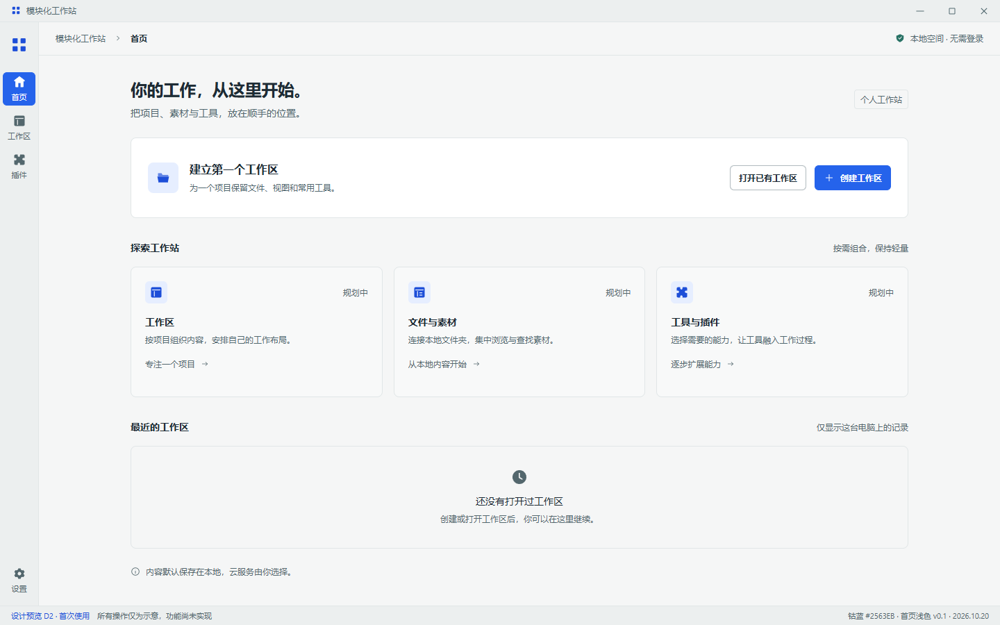
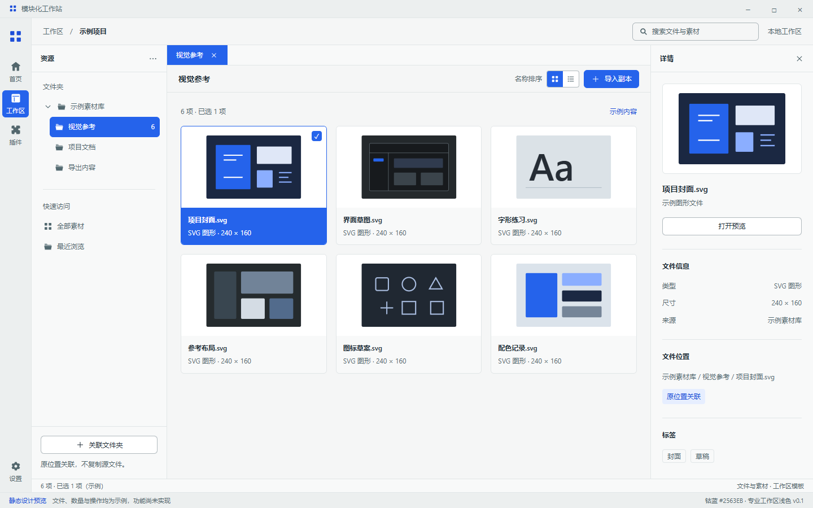
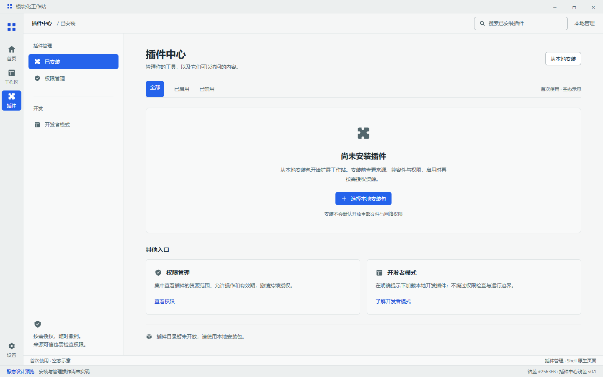
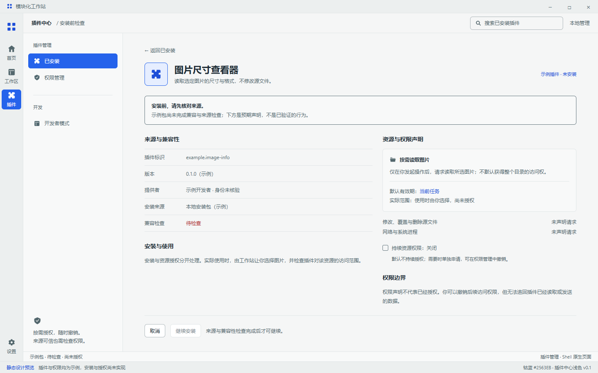

# D2 · 钴蓝浅色对照与深浅审阅入口

日期：2026-10-20｜版本：V0.1｜状态：深浅主稿齐备，完整状态与视觉验收未完成

关联：[Issue #12](https://github.com/2539426035852ningmao-cmyk/modular-workstation/issues/12)、[D1 配色规范](DESIGN_PROPOSAL_D1.md)、[首页深色](DESIGN_REVIEW_D2_HOME.md)、[素材工作区深色](DESIGN_REVIEW_D2_ASSETS.md)、[插件中心深色](DESIGN_REVIEW_D2_PLUGINS.md)。本轮复核 main 仍为 `1236f61`，PR #13–#18 仍待审；PR #17 的 13 项产品约束继续适用，跨插件自动协作未定案。

## 一页比较

在本地浏览器打开 [深浅主题对照页](design/d2-theme-review.html)，选择四个页面之一，可并排比较同一布局的两种主题。窄窗口上下排列，点击图片可打开对应独立源稿。页面选择是真实可操作的审阅导航；稿件内的创建、安装、文件与权限按钮仍只是示意。

## 浅色首页



## 浅色素材工作区



## 浅色插件中心



## 来源与权限对照



| 页面 | 独立源稿 | 窄窗口预览 |
| --- | --- | --- |
| 首页 | [HTML](design/d2-home-light.html) | [800px](design/previews/d2-home-light-800.png) / [400px](design/previews/d2-home-light-400.png) |
| 文件素材工作区 | [HTML](design/d2-assets-light.html) | [800px](design/previews/d2-assets-light-800.png) / [400px](design/previews/d2-assets-light-400.png) |
| 插件中心空态 | [HTML](design/d2-plugins-empty-light.html) | [800px](design/previews/d2-plugins-empty-light-800.png) / [400px](design/previews/d2-plugins-empty-light-400.png) |
| 安装前来源与权限 | [HTML](design/d2-plugins-permissions-light.html) | [800px](design/previews/d2-plugins-permissions-light-800.png) / [400px](design/previews/d2-plugins-permissions-light-400.png) |

主图均为 1440×900 CSS 画布、设备比例 1，含模拟系统标题栏及设计标识。首页窄图导出完整纵向内容；专业工作区和插件页在中央区域内部滚动，因此截图只显示当前视口。不是 Electron 截图或 Windows DPI 实测。

## 配色与一致性

- 主强调实色继续使用已选 **#2563EB**，按钮白字；浅色强调文字用 #1D4ED8，选中底面 #E6EEFF，焦点与选中边缘 #2563EB。
- 使用 D1 的同名 23 个浅色变量：背景 #F5F6F6、侧栏 #ECEFEF、白色表面 #FFFFFF，正文 #1E2B34。成功、警告和错误是独立语义色，不承担品牌强调。
- 浅色稿由对应深色源稿与 D1 配色生成，布局、文字、示例、面板断点保持一致。素材缩略图是内容本身，不随界面主题反色。
- 设计导出不是第二份运行时主题系统。`src/tokens.css` 仍是应用唯一来源，当前程序仍使用旧主题，尚未映射新稿。

## 实际验证与复现

已有开发依赖及 Microsoft Edge 的环境中，在仓库根目录运行：

```text
node docs/design/render-d2-light.cjs
node docs/design/verify-d2-theme-review.cjs
```

前者会先依据深色稿及 D1 重建浅色源稿和对照页，再导出预览与布局报告；后者核查对照页的选择与图片加载。只需重建源稿时可运行 `node docs/design/generate-d2-light.cjs`，不要直接手改生成的浅色 HTML。

- [浅色检查记录](design/previews/d2-light-validation.json)：四稿分别覆盖 1440/1120/800/640/400×900 及 800×540，共 **24 个静态案例通过**。无页面横向溢出；已检查标题、控件、文件名、权限行等未横向裁切，底部内容可滚动到达，全局设置可达。
- 四份浏览器计算样式均匹配 D1 的 **23 个浅色变量**，`color-scheme` 为 light；控制台错误与远程 HTTP 请求均为 0。报告记录浅色源文件 SHA-256（统一为 LF 换行后计算），便于跨平台核对预览来源。
- **58 组静态颜色对比检查通过**：48 组文字、9 组边界与焦点、1 组主按钮前景；文字及按钮阈值 4.5:1，边界阈值 3:1。已检查文字最低约 **4.90:1**，边界最低约 **4.08:1**。不把装饰分隔线、素材内容或禁用文字视为已通过相同阈值。
- 共导出 12 张预览，四张主图及四张 400px 窄图已人工查看。
- [审阅页检查记录](design/previews/d2-theme-review-validation.json)：四个页面选择均正确显示唯一内容，八张深浅图片加载成功；400px 无横向溢出，控制台错误为 0。
- 以上不等于应用主题切换、键盘/读屏、Windows DPI、插件隔离或文件操作通过。未改应用源码与依赖，未重复运行应用测试；Morphicons 尚未接入或测试。

## 状态缺口与唯一下一步

后续进展：[三类基础状态稿与恢复入口](DESIGN_REVIEW_D2_STATES.md)已制作，涵盖下表中的基础空白/加载/失败；本表保留本批主稿交付时的缺口记录。当前唯一下一步为汇总视觉审阅并据反馈收敛，完整 Shell 状态流与真实实现仍待后续任务。

| 页面/流程 | 已有稿 | 下一批需要补齐 |
| --- | --- | --- |
| 首页 | 深浅首次空态 | 工作区打开/创建中、失败与返回路径；真实最近记录待能力实现 |
| 文件素材 | 深浅示例内容与选中详情 | 首次空白、索引加载、无匹配、目录无权限、文件失联与恢复 |
| 插件中心 | 深浅无插件、来源/权限待检查 | 无匹配、兼容或安装失败、加载进度与取消请求反馈 |
| 统一 Shell | 导航与空间布局候选 | 故障标签、任务中断/手动继续、未保存关闭与异常安全启动的状态流 |

下一步先补 **三类页面的空白、加载与失败状态及恢复动作**，再将统一 Shell 的相关状态流分批整理；PR #17 的恢复/后台/任务约束不因有状态稿就成为已实现功能。之后汇总审阅，获视觉与实施确认后按小 PR 映射到真实应用。

回滚可撤销本设计提交，移除浅色源稿、导出及审阅入口；不影响现有桌面原型。#10 仍待产品验收，#4/#5 与 Electron/Tauri 对照继续保留；不能据此宣布 D2、S0 或 S1 全部完成。
