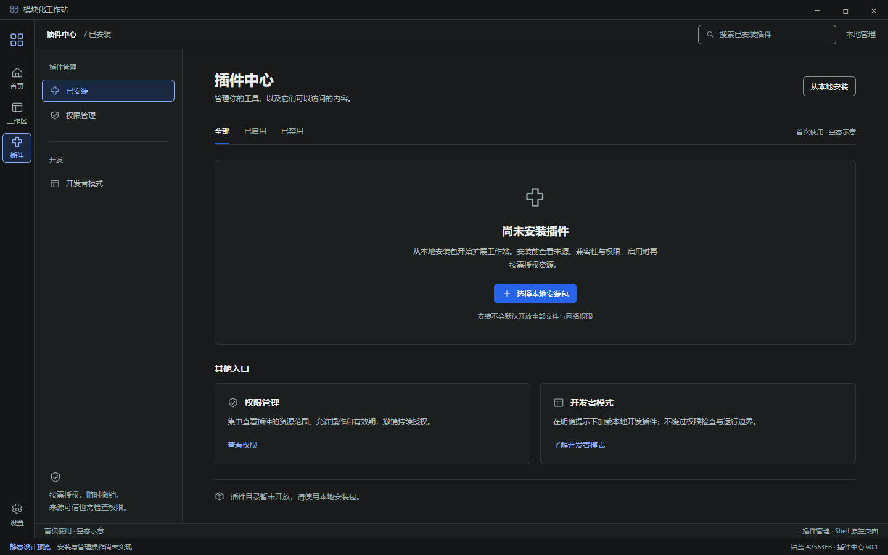
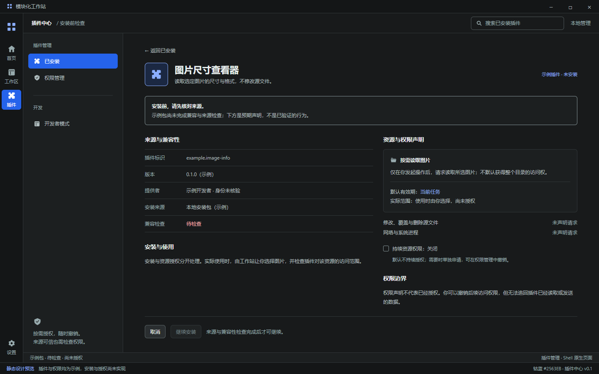

# D2 · 插件中心深色首稿

> P0 归档说明：本文保留历史设计与当时验证记录；当前有效视觉以 [DESIGN_PREFERENCES](DESIGN_PREFERENCES.md) 和 [DESIGN_FOUNDATIONS](DESIGN_FOUNDATIONS.md) 为准，当前任务与验收入口见 [P0 报告](P0_ACCEPTANCE.md)。旧配色、尺寸、箭头和未实现说明不能覆盖最新运行版本。

日期：2026-10-20｜版本：V0.1｜状态：静态候选，待视觉确认

关联：[Issue #12](https://github.com/2539426035852ningmao-cmyk/modular-workstation/issues/12)、[D1 提案](DESIGN_PROPOSAL_D1.md)、[首页稿](DESIGN_REVIEW_D2_HOME.md)、[素材工作区稿](DESIGN_REVIEW_D2_ASSETS.md)。延续 B 轻量首页、LobeHub 视觉氛围、Figma 工作台空间组织和已选钴蓝 #2563EB。

## 本次发现的新推送

2026-10-20 实际读取远端提交、分支、PR 与 Issue 评论：main 最新仍为 `1236f6160485a78ec933ae3922c2dac2ea080bda`（PR #11），未出现新的主线提交。新增 [PR #17](https://github.com/2539426035852ningmao-cmyk/modular-workstation/pull/17)，分支 `docs/confirmed-workstation-decisions-20261020`，头提交 `16164b4f0cbb9f6dac00b2c766951688f97cd53e`，尚未合并；#10 和 #12 已增加相应交接评论。

已直接读取该分支的 [13 项确认决策交接](https://github.com/2539426035852ningmao-cmyk/modular-workstation/blob/16164b4f0cbb9f6dac00b2c766951688f97cd53e/docs/HANDOFF_WORKSTATION_DECISIONS_2026-10-20.md)及 #12 原始记录。产品方向包括统一 Shell、插件内容区边界、受约束分屏、布局与会话恢复、未保存保护、故障隔离、资源监控、任务中心、后台与手动恢复、资源引用和最小资源授权。跨插件自动协作尚未确认；具体 SDK、隔离实现、组件库、框架及多数视觉细节仍需正式设计和验证。钴蓝选择另按 ADR-010 生效。

本次继续已获授权的 #12 静态设计准备，不将交接变为立即实现 13 项功能的任务，不改变 #10 的实施与验收边界，也不合并其他待审 PR。

## 预览一：首次使用空态

- [可编辑源稿](design/d2-plugins-empty-dark.html)、[800px](design/previews/d2-plugins-empty-dark-800.png)、[400px](design/previews/d2-plugins-empty-dark-400.png)。
- Rail 56px、分类侧栏 240px，中央为插件管理内容，不加专业 Inspector。
- 首次使用显示“尚未安装插件”，不虚构插件数量、在线目录、官方认证或运行指标。
- 本地安装为主入口；权限管理与开发者模式是未来入口，未实际实现。没有插件列表搜索结果，未制作已安装列表、无匹配、更新或卸载状态。

## 预览二：安装前来源与权限详情

- [可编辑源稿](design/d2-plugins-permissions-dark.html)、[800px](design/previews/d2-plugins-permissions-dark-800.png)、[400px](design/previews/d2-plugins-permissions-dark-400.png)。
- 详情在中央主体打开，保留分类侧栏，不额外堆叠详情 Inspector；未来返回列表时应恢复筛选与滚动位置。
- “图片尺寸查看器”、标识、版本、提供者和安装包均为示例；不提供真实安装包、签名或可信来源背书。
- 区分资源、操作、有效期：仅按需读取用户所选图片，默认当前任务；不默认开放目录、写入/删除、网络或系统进程。持续资源权限保持关闭，未来需独立申请并可撤销。
- 安装与资源授权分开，安装确认不自动授予任意文件访问。来源和兼容性仍为待检查，继续安装呈不可用状态。
- 界面表达权限声明与实际授权的区别；真正的强制鉴权、撤销与绕过测试属于 S3，不因本稿存在而成立。

## 目标流程与后续状态

| 环节 | 未来行为 | 当前交付 |
| --- | --- | --- |
| 本地包选择 | 校验清单、来源与版本兼容性 | 静态入口，无文件访问 |
| 安装前详情 | 展示来源、声明与实际检查结果 | 待检查示例，安装不可用 |
| 使用资源 | 用户选择范围，按插件/资源/操作/期限授权 | 当前任务与持续关闭的视觉说明 |
| 已安装列表 | 启用、禁用、更新、卸载及错误反馈 | 未制作，不能宣称生命周期闭环 |
| 权限管理 | 查看/撤销，说明撤销对既有数据的限制 | 导航入口与文字说明，未展开完整页面 |
| 任务、故障、退出恢复 | 统一 Shell 协调，插件按能力执行 | 依据 PR #17 保留设计约束，本轮不制作或实现 |

空态稿与详情稿是两个独立静态 HTML，没有点击跳转、搜索、筛选、安装、授权或窄窗口分类面板展开行为。加载、兼容失败、安装失败、无匹配、离线目录状态仍需补充，不能视为完整 D2 验收。

## 实际验证

- 已运行 `node docs/design/render-d2-plugins.cjs`；[验证记录](design/previews/d2-plugins-validation.json)随稿保存。
- 两张稿分别检查 1440/1120/800/640/400×900，以及 800×540，共 12 个静态布局案例通过；无页面或中央内容横向溢出，被检查标题、控件、来源值与权限行未横向裁切。
- 两份源稿分别与 D1 的 23 个颜色变量匹配；没有业务脚本、远程 HTTP 请求或控制台错误。全局设置与审阅标识保持可见，底部说明/安装操作可滚动到达。
- 1440/800/400 三种宽度各导出两张图，六张均已人工查看。宽稿为 1440×900 CSS 画布、设备比例 1，含模拟系统标题栏，不是应用截图。
- 未修改 `src/`、Electron、依赖或插件 SDK。未重复运行应用测试，未验证键盘、读屏、真实 Windows DPI、性能、安装隔离、资源鉴权或 Morphicons 动效。
- 回滚：撤销本设计提交；已运行桌面原型不受影响。

## 唯一下一步

[三类页面浅色对照与深浅审阅入口](DESIGN_REVIEW_D2_LIGHT.md)已制作；下一步补空白、加载与失败状态及恢复动作。深浅主稿齐备不等于交互、技术选型或用户视觉验收通过。#10 仍为待产品验收；#4/#5 和 Electron/Tauri 对照保留，S0/S1 未完成。
