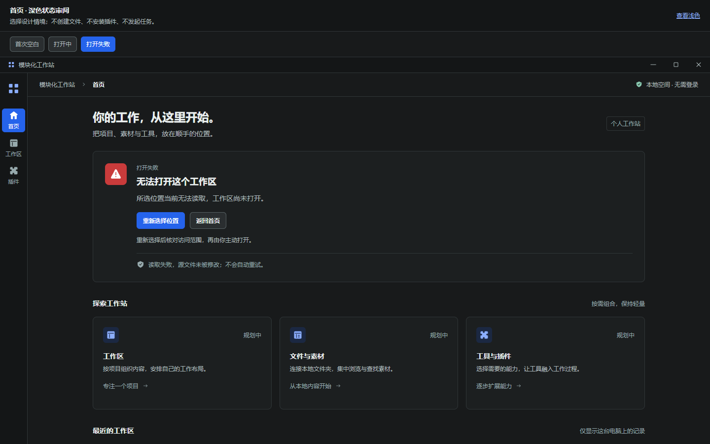
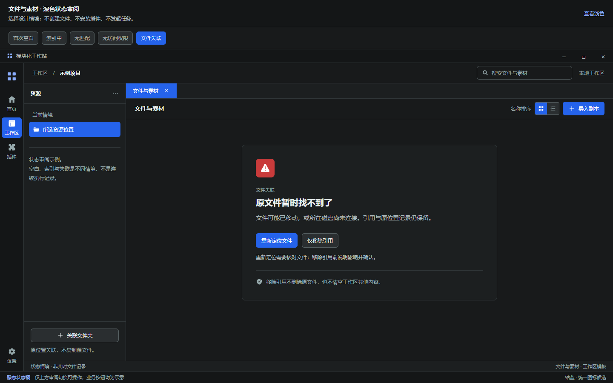
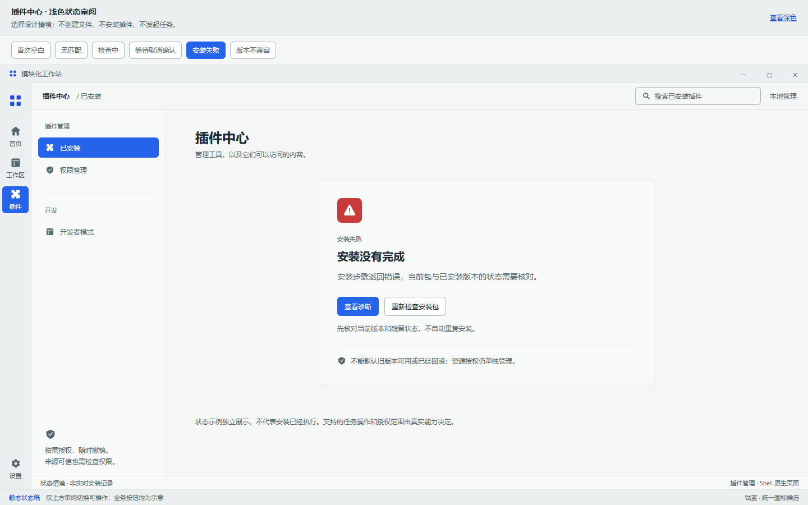

# D2 · 页面状态、恢复入口与统一图标候选

日期：2026-10-20｜状态：三类页面基础状态稿已制作，待视觉确认；不是业务实现或完整 D2 验收

关联：[#12 设计记录](https://github.com/2539426035852ningmao-cmyk/modular-workstation/issues/12)、[#19 现有设计 PR](https://github.com/2539426035852ningmao-cmyk/modular-workstation/pull/19)、[深浅主稿](DESIGN_REVIEW_D2_LIGHT.md)、[13 项决策对照与图标规范](DESIGN_SYNC_2026-10-20.md)。本轮远端 main 仍为 `1236f61`，没有新的合并；#13–#19 均待审，#10 仍是唯一主实施任务、待产品验收。

## 查看方式

打开 [状态审阅入口](design/d2-state-review.html)，点击对应深浅预览。在独立页面顶部选择设计情境，支持鼠标点击和原生单选框键盘方向键；顶部主题链接可查看另一主题。主题链接进入另一份稿件的首次空白，不保留当前情境选择。

审阅区能真实切换设计稿；窗口、导航和业务操作仍是静态图形，不会读取文件、安装插件或执行任务。静态页面没有脚本、网络资源与后台计时器；进度未知时用静态等待标识，不模拟百分比。

## 三类状态

| 页面 | 情境 | 恢复或退出入口 | 约束 |
| --- | --- | --- | --- |
| 首页 | 首次空白 | 创建 / 打开工作区 | 不编造最近记录 |
| 首页 | 打开中 | 返回首页 | 返回不等于已取消，不重复上次付费/覆盖操作 |
| 首页 | 打开失败 | 重新选择位置 / 返回首页 | 本情境仅读取失败，源文件未修改，不自动重试 |
| 素材 | 首次空白 | 关联文件夹 / 导入副本 | 原位引用与托管副本分开说明 |
| 素材 | 索引中 | 请求停止索引 | 未知总量无百分比，停止需执行方确认 |
| 素材 | 无匹配 | 清除搜索与筛选 | 不改文件或授权范围 |
| 素材 | 无访问权限 | 检查目录访问 / 选择其他文件夹 | 区分应用授权与系统限制，不建议管理员绕过 |
| 素材 | 文件失联 | 重新定位 / 仅移除引用 | 保留引用记录；移除前确认，不能删除原文件 |
| 插件 | 首次空白 | 选择本地安装包 | 文件选择、安装与资源授权分别确认 |
| 插件 | 无匹配 | 清除搜索与筛选 | 不自动联网、不删除或禁用插件 |
| 插件 | 检查中 | 请求取消检查 | 尚未执行插件代码，检查后仍需确认来源/权限 |
| 插件 | 等待取消确认 | 查看任务详情 | 已请求 ≠ 已停止，不能假装资源已经释放 |
| 插件 | 安装失败 | 查看诊断 / 重新检查安装包 | 不默认回滚成功、旧版本可用，不自动重装 |
| 插件 | 版本不兼容 | 选择其他包 / 查看兼容要求 | 不绕过兼容与权限检查 |

这是 14 个独立情境，各有深浅主题，共 28 个状态画面。顶部切换不是一个连续业务流程；授权、安装、取消、删除确认的真实实现及能力声明仍待后续独立任务。

## 预览

### 首页：打开失败



首页保留 B 模块结构；状态反馈只替换工作区起始区域，不把首页改成专业编辑器。

### 素材：文件失联



无选中对象时不显示 Inspector；窄窗口保留资源入口，当前情境没有详情可显示，因此移除详情按钮。

### 插件：安装失败



## 图标优化范围

根据用户后续反馈，图标已由线型候选修订为 **面型为主、线面结合** 的项目自绘 SVG：24×24 坐标，以实色轮廓、镂空与局部透明面保留细节，箭头、加号和关闭等动作仍用清楚线条。工作区用面板、插件用拼图、设置用对称齿轮；状态图标配合明确文字。选中控件改为钴蓝填充与白色前景，详见 [实色选中与图标修订](DESIGN_REVIEW_D2_SOLID.md)。

本次设计修订已同步至主稿与状态稿，真实应用尚未替换。Morphicons 尚未安装或实测，没有把 CSS 效果冒充 Morphicons 动画。若后续引入，仍按同步文档的减少动态效果、离线打包、许可和可访问性条件验证。

## 实际验证

已有项目开发依赖与 Microsoft Edge 的环境，在仓库根目录运行：

```text
node docs/design/verify-d2-states.cjs
```

脚本先从对应主稿与状态定义生成六份独立 HTML、一个审阅入口，然后检查并导出预览。只重建源稿可运行 `node docs/design/generate-d2-states.cjs`；不要手改生成的 HTML。

- [验证记录](design/previews/d2-states-validation.json)：14 情境 × 2 主题 × 6 窗口，共 **168 个静态状态案例通过**，窗口为 1440/1120/800/640/400×900 与 800×540。
- 每份源稿的计算颜色匹配 D1 的 **23 个主题变量**；无页面横向溢出，已检查标题、说明、操作及安全提示无横向裁切，安全提示可滚动到达。
- **36 个键盘案例通过**：原生单选方向键切换情境，焦点轮廓可见；所有情境均核对只显示一个匹配的状态卡。
- SVG 引用目标均存在；页面控制台错误与 HTTP 请求均为 0。审阅入口六张图片加载成功，400px 无横向溢出。
- 六张深浅主预览、素材 800/400px 窄预览和一张汇总图已导出；首次人工检查发现窄素材页残留无对象的详情入口和插件页旧空态页脚，已修正后重新验证。首页深色、素材深色/400px、插件浅色用于人工视觉核对。
- 报告包含六份最终源稿的 LF 规范化 SHA-256 摘要。此次未新增运行时依赖，未修改 `src`、Electron 或锁文件，未重跑应用构建/运行/安全测试。

检查不代表真实文件、安装、取消、授权、读屏、Windows DPI 或故障隔离能力通过。静态字号/布局截图也不能代替真实系统缩放验收。

## 尚缺与唯一下一步

本批覆盖三类页面基础状态；完整专业操作、安装中断后状态核对、故障标签、未保存关闭、异常安全启动、后台与任务恢复等 Shell 状态流尚未完整设计，不能宣布 D2 或阶段完成。13 项产品确认继续有效，具体工程方案保持按任务分批处理。

**唯一下一步：汇总现有深浅主稿与本批状态稿，依据产品负责人的视觉反馈收敛设计，再确定第一项获批的应用映射范围。** 不因状态稿完成就直接切换组件库或启动插件系统。#10 保持待产品验收，#4/#5 和 Electron/Tauri 对照继续保留。

回滚：撤销本次设计提交可移除状态源稿、生成/检查脚本、预览与索引，不影响现有桌面原型。
