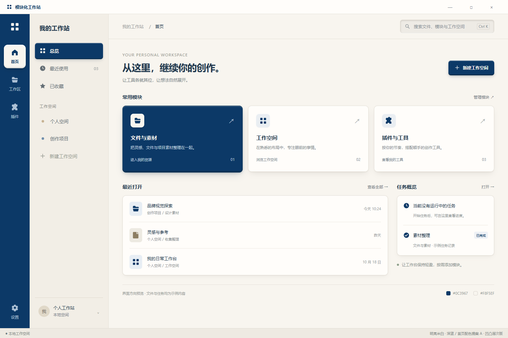

# 浅色首页方向归档 · 明亮米白、深蓝与轻微实体层次

日期：2026-10-20。来源：侧边设计讨论转交的产品负责人确认，最终反馈“不错不错，就是这种感觉”。关联 [Issue #12](https://github.com/2539426035852ningmao-cmyk/modular-workstation/issues/12) / [现有 PR #19](https://github.com/2539426035852ningmao-cmyk/modular-workstation/pull/19)。

## 已认可的方向

- 主背景明亮米白 `#F8F5EF`，搭配深蓝 `#0C3967`；替代较黄的 `#EAD0B0`，并更新此前浅色钴蓝候选。深色版仍在讨论，未验收。
- B 轻量模块首页、面型为主且结合线条的图标、实色导航及选中区域继续保持。选中前景按底色形成反差；深蓝侧栏中的首页入口为米白实体块。
- 搜索框微微内凹：顶部内阴影、底部细亮边。
- 首页选中入口、总览、新建工作空间主按钮和深蓝文件与素材卡片更明显凸起：顶部亮边、底部薄厚度、接触阴影与柔和投影；其余白色卡片较轻。
- 普通边框仍要轻。局部亮边用于表达表面关系，不恢复全套粗重边框，也不将每块表面做成强烈浮雕。

## 原样证据

[独立 HTML 样稿](design/workstation-ivory-home-tactile.html)（1440 × 960 固定画布；样稿原样归档，具体阴影参数保留在追加样式中）。

原始文件来自侧边讨论的 `workstation-ivory-home-tactile.html` 与同名 PNG；仓库副本与原文件逐字节一致。数据、文件、任务状态、快捷键与按钮均为视觉示例，不代表业务能力、用户真实数据或完整交互。

## 与现有工作的协调

本次仅归档、更新偏好和恢复索引，不直接覆盖原 D2 主稿或共用配色表；后续在 Issue #12 的既有设计流程中映射新的浅色 Token、层次与组件状态，再按真实修改更新检查。旧静态稿的钴蓝样式断言不应直接用于新浅色方案。

用户认可的是方向与层次感觉，不等于完整页面、可访问性、窄窗口或业务验收。此固定画布未通过新的响应式、键盘、对比度与功能测试；本次只检查归档完整性和文档链接。灰色辅助文字等仍须在正式映射时按实际底面检查可读性。

没有改动应用、依赖、主任务与阶段关卡；不实施插件系统或额外业务。撤销本归档提交可回滚，原样稿仍保留在侧边讨论目录。
